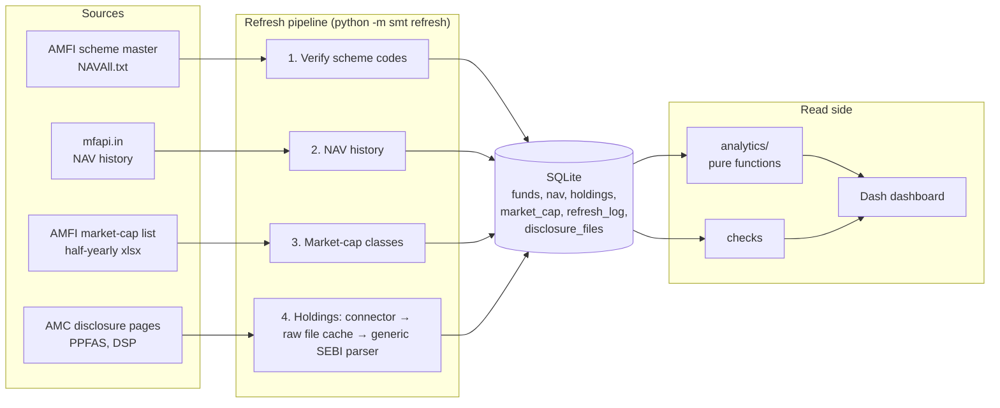

# Smart Money Tracker

Analytics for Indian equity mutual funds built only on official, verifiable data:

- **Returns and risk** from AMFI NAV history.
- **Holdings** from the monthly portfolio disclosures SEBI requires every AMC to publish.

It answers two kinds of question:
- **How good is a fund?** Returns, risk, SIP outcomes and peer rank.
- **What is its manager actually doing?** Which stocks were bought or sold, how much two funds overlap, and whether a fund stays inside its SEBI category.

```bash
pip install -r requirements.txt
python -m smt refresh        # download, validate and store (about 2 minutes the first time)
python -m smt check          # data-quality report
python -m smt serve          # dashboard at http://127.0.0.1:8050
python -m pytest             # 73 offline tests
```

## What it covers

| | Funds | Data |
|---|---|---|
| **NAV analytics** | 20 funds from 9 AMCs, plus a Nifty 50 index fund as benchmark | Full daily NAV history |
| **Holdings analytics** | 11 funds: 3 from PPFAS, 8 from DSP | Last 6 month-end portfolios, every security |

### Dashboard tabs

| Tab | What it shows |
|---|---|
| **Scorecard** | 1Y/3Y/5Y returns, volatility, Sharpe, max drawdown, beta, alpha, rank within SEBI category |
| **Fund** | Growth of ₹10,000 vs benchmark, rolling 3-year returns, drawdowns, calendar-year returns |
| **SIP** | Monthly SIP simulation with XIRR, for any set of funds and start year |
| **Portfolio builder** | Correlation of funds, efficient frontier, max-Sharpe and min-volatility mixes |
| **Holdings** | Asset, sector and market-cap mix; concentration; month-on-month buys and sells; style drift vs SEBI rules |
| **Smart money** | Stocks most bought and sold across all tracked funds, in ₹ crore |
| **Overlap** | How much two portfolios overlap, plus a matrix of every pair |
| **Data status** | Every data-quality check, fund verification, refresh log and source file used |

Example from the September 2026 data: PPFAS Flexi Cap raised its DLF stake from 13.7M to 52.8M shares, about ₹2,600 crore. That took DLF from 0.6% to 2.5% of the fund.

## Architecture



```
smt/
├── universe.py              the funds, by AMFI scheme code + the name AMFI must report for it
├── sources/amfi.py          scheme master and market-cap list (pure parse_* + fetch_*)
├── sources/mfapi.py         NAV history
├── holdings/parser.py       one parser for every AMC's SEBI-format portfolio sheets
├── holdings/connectors/     per-AMC: find the files, download them (ppfas.py, dsp.py)
├── pipeline.py              the refresh steps, each logged and isolated
├── store.py                 SQLite schema, writes (pipeline only) and reads
├── checks.py                data-quality checks
├── analytics/               performance, sip, portfolio, holdings: pure pandas functions
└── dashboard/               Dash app: data loading, figures, layout and callbacks
```

## Design decisions

- **The web app never calls the internet.** The refresh pipeline is the only writer; the dashboard only reads SQLite. Pages load instantly, and a source going down only makes the data older. The Data status tab shows how old.
- **Scheme codes are verified on every refresh.** Each fund lists the name AMFI must report for its code. A mismatch is logged, the fund is excluded, and `smt check` fails. Version 1 had wrong codes for 24 of its 28 funds. Some pointed at debt funds and schemes closed years ago, and nothing noticed.
- **Buying and selling are measured in shares, not weights.** A weight rises when a stock's price rises; a share count only rises when the fund buys. A share count that doubles while the weight stays flat is flagged as a likely split or bonus, not called a purchase.
- **One parser, many AMCs.** SEBI fixes the columns of a portfolio disclosure but not the layout. The parser finds the header row and columns by their text, tracks section headings, and stops at GRAND TOTAL. It handles fractions or percentages, values in lakh or crore, and .xlsx, .xls or HTML-as-.xls files. A connector only has to find and download files: about 30 lines per AMC.
- **Arbitrage stays separate from investing.** Stocks bought and hedged with futures are tagged `Equity - Arbitrage`. REITs, foreign stocks and overseas funds each get their own class, so "equity %" means directional Indian stock exposure.
- **The benchmark is investable.** The Nifty 50 benchmark is the UTI Nifty 50 index fund's NAV. It includes that fund's small cost, which makes the comparison fair to active funds.
- **Every number has a source.** Downloaded disclosure files are kept in `data/raw/`, and `disclosure_files` records each URL, month, size and the schemes matched. Re-parsing after a parser fix never re-downloads.
- **Market-cap classes follow AMFI's official list.** That list puts the top 100 companies in large cap and 101–250 in mid cap. A stock split changes the ISIN but keeps its first 9 characters, which are used as a fallback key. That lifts coverage from 97% to 99.9% of equity weight.

## Data quality

`python -m smt check`, also shown on the Data status tab:

| Check | Why |
|---|---|
| Scheme codes match AMFI names | catches wrong or reused codes |
| NAV is current for every fund | catches a source that stopped updating |
| At least one year of NAV history | warns on new funds, whose risk numbers would mislead |
| Latest month present for every holdings fund | catches an AMC renaming its files |
| Securities with an ISIN add up to 60–101% of NAV | catches a parser reading the wrong column or table |
| Cash, TREPS and derivatives under 15% | flags funds with unusual non-stock exposure (warning only) |
| Indian stocks with an AMFI market-cap class | style drift is only as good as this coverage |

## Tests

**73 offline tests:**
- **Parser:** SEBI workbooks built in code, in both AMCs' layouts, with sections, arbitrage, REITs, foreign stocks, footnote tables, every date format and percent scale.
- **Connectors:** link discovery from saved page snippets, including DSP's inconsistent file names.
- **Analytics:** checked against hand-computed answers, for example a NAV compounding at exactly 10% a year, XIRR roots, and a min-volatility portfolio favouring the calmest fund.
- **Pipeline:** full runs with fake sources, covering a wrong scheme code, a failing fund, cache reuse and idempotent reruns.
- **Dashboard:** every Dash callback run through Flask on a seeded database.

**Live tests:** `SMT_LIVE_TESTS=1 python -m pytest tests/test_live.py` checks the real sources. It verifies every scheme code against today's AMFI list and confirms each connector finds and parses its latest month.

## Adding an AMC

1. Write `smt/holdings/connectors/<amc>.py`: subclass `Connector` and implement `discover()` to return the month-end file URLs. Override `keep_member()` if the AMC ships zips.
2. Register it in `smt/holdings/connectors/__init__.py`.
3. Set `holdings="<amc>"` on its funds in `smt/universe.py`, then add a discovery test with a saved snippet of its page.

HDFC, ICICI Prudential, SBI, Axis, Kotak, Mirae Asset and UTI load their disclosure lists with JavaScript or block scripted requests. Supporting them would need a headless browser, so they are NAV-only for now.

## Limitations

- **Past data only.** All analytics describe the past. The portfolio builder's weights summarise past returns; they are not a forecast or advice.
- **Monthly holdings.** Disclosures are monthly, so a stock bought and sold within a month is invisible.
- **Half-yearly market-cap list.** AMFI updates it twice a year and funds get time to rebalance. A small shortfall against a SEBI rule is a flag to investigate, not proof of a breach.
- **Registered NAV dates.** NAVs come from mfapi.in, a free mirror of AMFI's archive. Holiday gaps are handled by using the last NAV on or before each date.

## Deploying

- **Render:** `render.yaml` refreshes the data at build time, then serves with gunicorn.
- **Docker:** the container refreshes on start, then serves.

```bash
docker build -t smart-money-tracker . && docker run -p 8050:8050 smart-money-tracker
```

Settings (environment variables):
- `SMT_DB_PATH`
- `SMT_DATA_DIR`
- `SMT_RISK_FREE_RATE` (default 6.5%)
- `SMT_HOLDINGS_MONTHS` (default 6)
