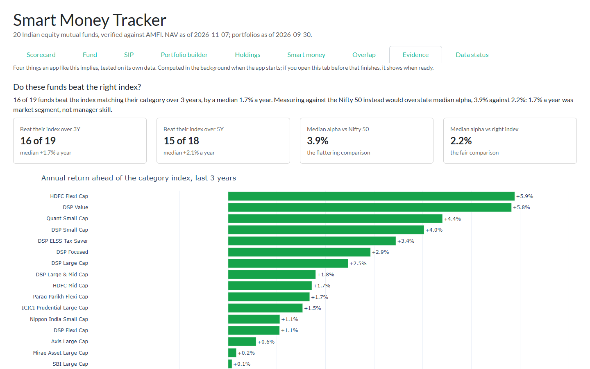
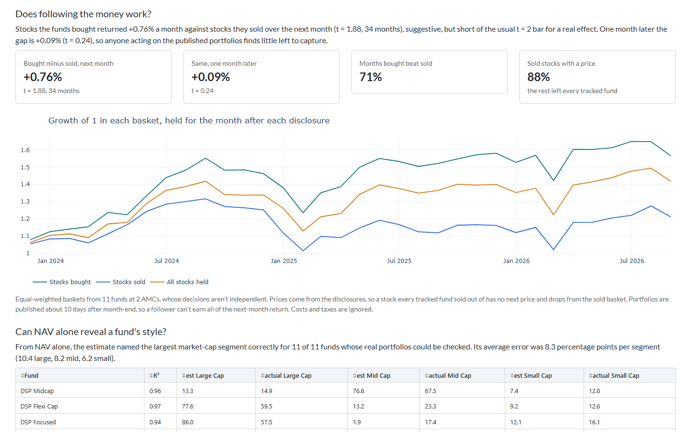
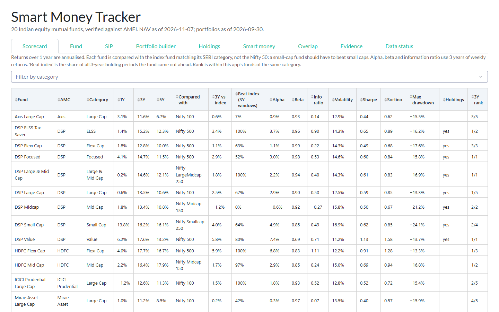
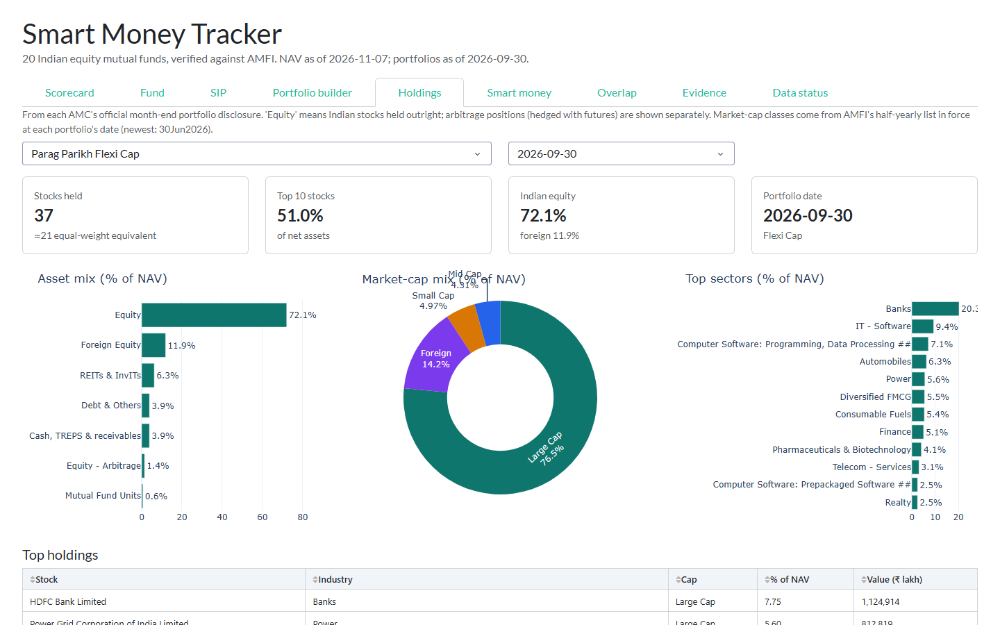
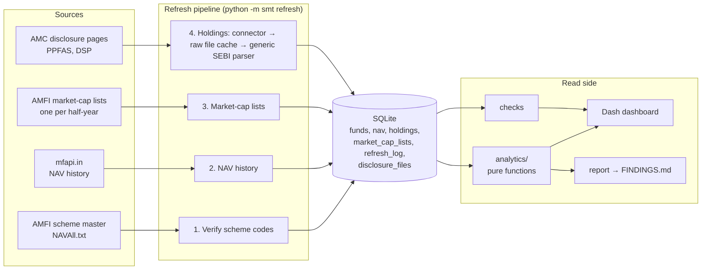

# Smart Money Tracker

Analytics for Indian equity mutual funds built only on official, verifiable data:

- **Returns and risk** from AMFI NAV history.
- **Holdings** from the monthly portfolio disclosures SEBI requires every AMC to publish.

It answers three kinds of question:
- **How good is a fund?** Returns and risk against the index matching its category, SIP outcomes and peer rank.
- **What is its manager actually doing?** Which stocks were bought or sold, how much two funds overlap, and whether a fund stays inside its SEBI category.
- **Do the usual claims hold up?** Whether active funds beat their index, whether copying their trades works, whether NAV alone reveals a fund's style, and whether an optimiser beats equal weight. Each is tested on the app's own data.

```bash
pip install -r requirements.txt
python -m smt refresh        # download, validate and store (a few minutes the first time)
python -m smt check          # data-quality report
python -m smt report         # write FINDINGS.md, computed from the data
python -m smt serve          # dashboard at http://127.0.0.1:8050
python -m pytest             # 124 offline tests
```

## Findings

**[FINDINGS.md](FINDINGS.md)** is generated by `python -m smt report`, so no number in it is typed by hand. It also heads the dashboard's Evidence tab. From the November 2026 data:

1. **Half of the measured alpha was benchmark choice.** 16 of 19 funds beat the index matching their category over 3 years, by a median 1.7% a year. Measured against the Nifty 50 instead, median alpha is 3.9% rather than 2.2%: a small-cap fund gets credit for the small-cap premium. These are large, surviving, well-known funds, so the beat rate isn't representative of active funds.
2. **Copying the funds' trades doesn't leave much to capture.** Stocks the funds actively bought beat stocks they sold by 0.76% a month in the following month (t = 1.88, 34 months). That is suggestive, but short of the usual bar for a real effect, and it falls to 0.09% (t = 0.24) a month later, once a follower could act on the published portfolio.

   Repeated on seven other cuts of the data, the gap stays positive in all of them, but nearly all of it came from Nov 2023 – Mar 2025 (+1.45%/month); since then it is +0.06%. Two of the eight cuts cross t = 2, about what chance alone produces when you test that many.
3. **NAV alone tells a large-cap fund from a small-cap one.** Returns-based style analysis named the largest market-cap segment correctly for all 11 funds whose real portfolios could be checked, with an average error of 8.3 percentage points per segment. That makes it usable for the 9 funds whose AMCs don't publish scriptable holdings.
4. **The optimiser doesn't beat equal weight out of sample.** Refitted every 6 months on past data only, across 17 funds from 2016, the max-Sharpe mix returned 15.5% a year against 16.0% for equal weight (gap t = −0.22).





## What it covers

| | Funds | Data |
|---|---|---|
| **NAV analytics** | 20 funds from 9 AMCs | Full daily NAV history |
| **Reference series** | 6 index funds (Nifty 50, 100, LargeMidcap 250, Midcap 150, Smallcap 250, 500) and a liquid fund for cash | Full daily NAV history |
| **Holdings analytics** | 11 funds: 3 from PPFAS, 8 from DSP | 36 month-end portfolios, every security |

### Dashboard tabs

| Tab | What it shows |
|---|---|
| **Scorecard** | 1Y/3Y/5Y returns, then against the category index: return ahead, share of 3-year periods ahead, alpha, beta, information ratio. Also volatility, Sharpe, Sortino, max drawdown and rank within category |
| **Fund** | Growth of ₹10,000 against its category index, rolling 3-year returns, drawdowns, calendar-year returns, and the market-cap mix estimated from NAV |
| **SIP** | Monthly SIP simulation with XIRR, for any set of funds and start year |
| **Portfolio builder** | Correlation of funds, efficient frontier, max-Sharpe and min-volatility mixes |
| **Holdings** | Asset, sector and market-cap mix; concentration; month-on-month buys and sells; style drift against SEBI rules |
| **Smart money** | Stocks most bought and sold across all tracked funds, in ₹ crore |
| **Overlap** | How much two portfolios overlap, plus a matrix of every pair |
| **Evidence** | The four findings above, with their charts and tables |
| **Data status** | Every data-quality check, fund verification, refresh log and source file used |





## Architecture



```
smt/
├── universe.py              funds by AMFI code + the name AMFI must report; former names; category → index
├── sources/amfi.py          scheme master and market-cap lists (pure parse_* + fetch_*)
├── sources/mfapi.py         NAV history
├── holdings/parser.py       one parser for every AMC's SEBI-format portfolio sheets
├── holdings/connectors/     per-AMC: find the files, download them (ppfas.py, dsp.py)
├── pipeline.py              the refresh steps, each logged and isolated
├── store.py                 SQLite schema, writes (pipeline only) and reads
├── checks.py                data-quality checks
├── report.py                FINDINGS.md, and the sentences that head the Evidence tab
├── analytics/
│   ├── performance.py       returns, risk, active return, tracking error, rolling hit rate
│   ├── holdings.py          snapshots, corporate actions, buys and sells, overlap, style drift
│   ├── flows.py             event study: do the funds' trades predict returns?
│   ├── style.py             returns-based style analysis, validated against holdings
│   ├── portfolio.py         efficient frontier and the walk-forward test
│   ├── sip.py               SIP simulation and XIRR
│   └── evidence.py          the four Evidence questions, shared by dashboard and report
└── dashboard/               Dash app: data loading, figures, components, layout and callbacks
```

## Design decisions

- **The web app never calls the internet.** The refresh pipeline is the only writer; the dashboard only reads SQLite. Pages load instantly, and a source going down only makes the data older. The Data status tab shows how old.
- **Scheme codes are verified on every refresh.** Each fund lists the name AMFI must report for its code. A mismatch is logged, the fund is excluded, and `smt check` fails. Version 1 had wrong codes for 24 of its 28 funds. Some pointed at debt funds and schemes closed years ago, and nothing noticed.
- **Each fund is judged against its own category's index.** A small-cap fund measured against the Nifty 50 gets credit for the small-cap premium. Each SEBI category maps to the index fund matching its mandate, and the index fund's NAV includes its real cost, which keeps the comparison fair to active funds.
- **Beta and alpha use weekly returns.** A fund's NAV and an index don't close at the same moment: foreign holdings strike on another clock and small caps react late. Daily beta therefore comes out too low and alpha too high. For DSP Small Cap, daily beta is 0.84 and weekly is 0.92.
- **Buying and selling are measured in shares, not weights.** A weight rises when a stock's price rises; a share count only rises when the fund buys.
- **Corporate actions are not trades.** Bonuses and splits multiply share counts, and a split also changes the ISIN. A demerger hands holders shares in a new company. Each is detected from two independent signals:
  - A fund that didn't trade lands on an exact clean multiple.
  - The disclosed price per share falls by the same ratio.

  Earlier share counts are then restated. Over 36 months this finds 33 bonuses and splits, including HDFC Bank's 1:1 bonus, Bajaj Finance's 10× and Trent's 1:2 (a rule looking for "shares doubled" misses 1.5×). It also finds demergers such as ITC Hotels. Before this, ITC Hotels showed as ₹191 crore of buying by six funds.
- **Market-cap classes are point-in-time.** AMFI publishes a list every half-year. Each portfolio is classified with the list in force at its date, not today's. A stock split changes the ISIN but keeps its first 9 characters, which are used as a fallback key; that lifts coverage from 97% to 99.9% of equity weight. AMFI moved its newest list to another host in 2026, so both hosts are tried.
- **Renamed funds keep their history.** Funds are matched to disclosure files by name. DSP renamed four funds in 2025 (Top 100 Equity became Large Cap, for example), and both AMCs renamed their ELSS funds. Each fund lists its former names, checked by the portfolios carrying over stock for stock across the rename.
- **One parser, many AMCs.** SEBI fixes the columns of a portfolio disclosure but not the layout. The parser:
  - finds the header row and the columns by their text;
  - tracks section headings and stops at GRAND TOTAL;
  - handles fractions or percentages, values in lakh or crore, and .xlsx, .xls or HTML-as-.xls files.

  A connector only has to find and download files: about 30 lines per AMC. A file whose month can't be read is reported, not dropped silently.
- **Arbitrage stays separate from investing.** Stocks bought and hedged with futures are tagged `Equity - Arbitrage`. REITs, foreign stocks and overseas funds each get their own class, so "equity %" means directional Indian stock exposure.
- **Every number has a source.** Downloaded disclosure files are kept in `data/raw/`, and `disclosure_files` records each URL, month, size and the schemes matched. Re-parsing after a parser fix never re-downloads.
- **Findings are generated, not written.** `smt/report.py` writes FINDINGS.md from the analytics, and each sentence picks its wording from the numbers. A result that stops being significant after a refresh stops being described as significant.

## Data quality

`python -m smt check`, also shown on the Data status tab:

| Check | Why |
|---|---|
| Scheme codes match AMFI names | catches wrong or reused codes |
| NAV is current for every fund | measured against today, so a source that stops updating for every fund at once still fails |
| At least one year of NAV history | warns on new funds, whose risk numbers would mislead |
| Latest month present for every holdings fund | catches an AMC renaming its files |
| Holdings are recent | warns when the newest portfolio is more than 45 days old |
| No month missing inside each fund's history | catches a file that couldn't be dated or matched. This check found DSP's March 2026 file, skipped because of its name (`...-31march2026.zip`) |
| Securities with an ISIN add up to 60–101% of NAV | catches a parser reading the wrong column or table |
| Cash, TREPS and derivatives under 15% | flags funds with unusual non-stock exposure (warning only) |
| Indian stocks with an AMFI market-cap class | style drift is only as good as this coverage |
| Market-cap list is the latest half-year | caught the app silently using a 10-month-old list after AMFI moved the file |

## Tests

**124 offline tests:**
- **Parser:** SEBI workbooks built in code, in both AMCs' layouts, with sections, arbitrage, REITs, foreign stocks, footnote tables, every date format and percent scale.
- **Connectors:** link discovery from saved page snippets, including DSP's inconsistent file names and one with no separator before the month.
- **Analytics:** checked against hand-computed answers, for example:
  - a NAV compounding at exactly 10% a year;
  - Sortino's downside deviation, and a fund lagging its index by a day, whose true beta of 1 shows as about 0 on daily data;
  - corporate actions: a 1:2 bonus, a split with a new ISIN, a purchase in a falling stock that must *not* be read as a bonus, and a demerger;
  - the event study, which finds a planted signal and finds nothing in noise;
  - style analysis, which recovers a known 60/30/10 mix;
  - the walk-forward test, whose out-of-sample returns don't change when future data is rewritten.
- **Pipeline:** full runs with fake sources, covering:
  - a wrong scheme code, a failing fund, cache reuse and idempotent reruns;
  - point-in-time market-cap classes, a renamed fund, an undatable file;
  - checks measured against today, a stale market-cap list, a month missing mid-history.
- **Dashboard:** every Dash callback run through Flask on a seeded database, plus the generated report.

**Live tests:** `SMT_LIVE_TESTS=1 python -m pytest tests/test_live.py` checks the real sources. It verifies every scheme code against today's AMFI list, confirms each connector finds and parses its latest month, and fails if any file on a disclosure page can't be dated.

## Adding an AMC

1. Write `smt/holdings/connectors/<amc>.py`: subclass `Connector` and implement `discover()` to return the month-end file URLs. Override `keep_member()` if the AMC ships zips.
2. Register it in `smt/holdings/connectors/__init__.py`.
3. Set `holdings="<amc>"` on its funds in `smt/universe.py`, then add a discovery test with a saved snippet of its page.

HDFC, ICICI Prudential, SBI, Axis, Kotak, Mirae Asset and UTI load their disclosure lists with JavaScript or block scripted requests. Supporting them would need a headless browser, so they are NAV-only. The NAV-based style estimate covers part of that gap.

## Limitations

- **Past data only.** All analytics describe the past. The portfolio builder's weights summarise past returns; they are not a forecast or advice.
- **A hand-picked group of survivors.** The 20 funds are large and well known, and all still exist. Beat rates and the walk-forward test describe this group, not active funds in general.
- **Monthly holdings.** Disclosures are monthly, so a stock bought and sold within a month is invisible.
- **Corporate actions:**
  - **Mergers aren't handled.** An acquired company still shows as an exit, and the acquirer as a purchase.
  - **Small bonuses can be missed.** A bonus below 1.5× needs two funds landing on the multiple exactly, so a small bonus in a stock only one fund holds can be read as buying.
- **Half-yearly market-cap list.** AMFI updates it twice a year and funds get time to rebalance. A small shortfall against a SEBI rule is a flag to investigate, not proof of a breach.
- **NAV source.** NAVs come from mfapi.in, a free mirror of AMFI's archive. Holiday gaps are handled by using the last NAV on or before each date.

## Deploying

- **Render:** `render.yaml` refreshes the data at build time, then serves with gunicorn.
- **Docker:** the container refreshes on start, then serves.

```bash
docker build -t smart-money-tracker . && docker run -p 8050:8050 smart-money-tracker
```

Settings (environment variables):
- `SMT_DB_PATH`
- `SMT_DATA_DIR`
- `SMT_RISK_FREE_RATE` (default 6.5%)
- `SMT_HOLDINGS_MONTHS` (default 36)
